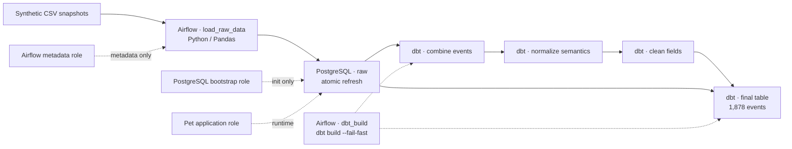

# Pet Event Analytics Platform

A production-minded local ELT reference implementation that turns synthetic pet
health and activity CSV snapshots into a tested, owner-enriched event table with
Apache Airflow, PostgreSQL, dbt, Python/Pandas, Docker Compose, and GitHub Actions.

The project is intentionally **single-node and batch-oriented**. Its purpose is to
demonstrate reliability, reproducibility, data contracts, failure handling,
observability, and evidence-based performance decisions without adding distributed
infrastructure that the workload does not require.

## What this portfolio demonstrates

- Atomic full-refresh ingestion: all raw tables commit together or roll back together.
- Fail-fast physical source contracts before PostgreSQL is modified.
- Dedicated PostgreSQL roles for cluster bootstrap, application data, and Airflow metadata.
- Deterministic source-row identity for repeatable event IDs.
- Airflow orchestration with retries, timeouts, serialized DAG runs, health checks, and persistent logs.
- dbt lineage, model contracts, data tests, unit tests, and row reconciliation.
- No Docker socket inside Airflow and read-only source/config mounts.
- Clean-room CI that builds a fresh runtime, uses generated credentials/volumes, executes the real DAG twice, and proves rollback after a forced database failure.
- Structured ingestion audit logs with file size, SHA-256, rows read/loaded, and timing.
- A disposable benchmark harness that measures the real DAG and captures PostgreSQL `EXPLAIN (ANALYZE, BUFFERS)` evidence before tuning.

This is a **local production-minded reference architecture, not a production
Airflow cluster**. The sample records are deterministic synthetic fixtures and do
not describe real people or pets.

## Architecture



Docker Compose runs two permanent services: PostgreSQL `15.19` and a custom
Apache Airflow `3.3.1` image. dbt Core `1.11.11` with dbt-postgres `1.11.0`
runs in an isolated virtual environment inside the Airflow image. Intermediate
dbt transformations are views; the final model is a table.

See [docs/architecture.md](docs/architecture.md) for component responsibilities,
failure boundaries, and design trade-offs.

## Portfolio engineering work

This repository is derived from an MIT-licensed upstream implementation. The
portfolio work focuses on hardening and making the system reproducible and
operable rather than claiming a from-scratch origin.

The refactor adds or strengthens:

- portable configuration and removal of machine-specific paths;
- an owned, versioned Airflow runtime;
- dbt isolation without a Docker socket dependency;
- atomic raw ingestion and rollback propagation;
- serialized Airflow execution for full-refresh safety;
- deterministic synthetic fixtures and explicit event identity;
- physical input parsing plus dbt semantic contracts;
- dbt unit/data tests and end-to-end row reconciliation;
- disposable clean-room CI with repeated-run and forced-failure checks;
- dedicated database roles and reduced runtime privileges;
- ingestion audit logging and performance benchmark tooling;
- operational, architecture, performance, and publication documentation.

Attribution and the upstream boundary are documented in [NOTICE.md](NOTICE.md).

## Data product and contracts

| Relation | Rows | Grain |
| --- | ---: | --- |
| `raw.raw_users` | 522 | One pet with owner attributes |
| `raw.raw_pet_health` | 940 | One health source record |
| `raw.raw_pet_activity` | 938 | One activity source record |
| `public_final.final_join_w_users_4` | 1,878 | One source event enriched with owner data |

Health and activity sources receive a one-based `source_row_number` before
insertion. dbt creates stable fixture-scoped event IDs such as `health:17` and
`activity:17`. The identifier is deliberately tied to source file order; it is
not presented as a general event identity strategy for mutable production feeds.

`event_source` separates health and activity provenance. Health events have
`duration_minutes = 0`; activity `-` or blank duration becomes `NULL`. Activity
names are trimmed and standardized. The final table enforces column types and
checks event uniqueness, required attributes, accepted categories, semantics,
relationships, and row reconciliation.

## Reliability and failure semantics

All source files are opened, header-checked, physically typed, hashed, and counted
before a database connection is used. Raw table creation/migration, truncation,
and inserts execute inside one SQLAlchemy transaction. A load exception rolls the
entire raw refresh back and is re-raised so Airflow records failure.

The DAG runs `load_raw_data >> dbt_build`, has `max_active_runs=1`, one retry after
30 seconds, an eight-minute task timeout, and a twenty-minute DAG timeout. The
clean-room validator runs the DAG twice and compares the full business snapshot,
then injects a real PostgreSQL type failure and confirms the previous database
state is restored.

The raw transaction and dbt build are separate publication boundaries. A dbt
failure after a successful raw commit can leave the new raw snapshot available;
consumers must treat Airflow DAG success as the refresh publication signal.

## Quick start

Prerequisites: Git, Docker Engine/Desktop with Compose v2 and Linux containers.
Allocate at least 4 GB to Docker; 8 GB is preferable for Airflow. Python 3.12 is
needed only for host-side development tests and helper scripts.

From a clean clone:

```sh
cd dockerized_dbt_postgresql_etl/dbt-PostgreSQL-ELT
cp .env.example .env
# PowerShell: Copy-Item .env.example .env
```

Edit `.env` and replace all three password placeholders with distinct local
passwords. The PostgreSQL bootstrap credential is not passed to Airflow; the pet
application and Airflow metadata use separate roles/databases.

```sh
docker compose config --quiet
docker compose build af
docker compose up -d --wait --wait-timeout 360
docker compose ps
```

Open Airflow at `http://localhost:8000`. Retrieve the local Simple Auth Manager
password privately:

```sh
docker compose exec af cat /opt/airflow/state/passwords.json
```

Then trigger the pipeline:

```sh
docker compose exec af airflow dags unpause load_raw_data_and_transform
docker compose exec af airflow dags trigger load_raw_data_and_transform
docker compose exec af airflow dags list-runs -d load_raw_data_and_transform
```

Query the final product from PostgreSQL on `127.0.0.1:5433` with the configured
`PET_DB_USER` / `PET_DB_NAME` credentials.

## Validation and CI

Host-side checks from the repository root:

```sh
python -m venv .venv
# POSIX: . .venv/bin/activate
# PowerShell: .venv\Scripts\Activate.ps1
python -m pip install -r requirements-dev.txt
python -m ruff check .
python -m pytest -q
```

The disposable end-to-end proof is:

```sh
python scripts/validate.py
```

It ignores the developer `.env`, creates a random Compose project, generates
separate synthetic credentials, builds the Airflow image, creates fresh volumes,
waits for service health, verifies DAG imports, executes the real DAG twice,
checks every expected business row, proves rollback with a forced database error,
verifies dbt results/logs and Docker-socket absence, and removes only resources
owned by that invocation. Diagnostic and cleanup failures are best-effort and do
not replace the original pipeline exception.

GitHub Actions runs Ruff, pytest, and this same clean-room validation on pushes and
pull requests. There is intentionally no deployment/CD target.

### Verified release evidence

The final local release candidate was rebuilt in a disposable Compose project and
validated end to end. The recorded evidence is:

| Check | Result |
| --- | --- |
| Python host tests | 18 passing |
| Ruff | passing |
| dbt build | 42/42 passing (`36` data tests, `2` unit tests, `4` models) |
| DAG executions | two consecutive successful runs |
| Business output | 1,878 final events on both runs |
| Repeatability | identical business snapshot on the second run |
| Forced database failure | rollback restored the complete prior raw state |
| Docker socket inside Airflow | absent |
| Clean-room validation | `CLEAN_ROOM_PASS=true`, exit code `0` |

These are validation results for this repository version, not a production SLA.

## Performance approach

The production fixture is small (~2.4k input records), so this repository does not
claim that PostgreSQL `COPY`, indexes, or incremental loading are automatically
better. Full refresh is a deliberate fit for complete static snapshots.

Use the isolated benchmark harness to measure before changing the load path:

```sh
python scripts/benchmark.py --scales 1 100 --output .validation/benchmark.json
# Optional stress boundary:
python scripts/benchmark.py --scales 1 100 1000 --output .validation/benchmark-stress.json
```

The harness measures Airflow task/DAG duration, validates output cardinality, and
captures PostgreSQL `EXPLAIN (ANALYZE, BUFFERS, FORMAT JSON)` for the final join.
It uses a random `pet-benchmark-*` Compose project and never uses the developer
project or global Docker cleanup.

A measured local benchmark of the final release candidate produced:

| Scale | Events | Load task | dbt task | DAG wall | Final query |
| ---: | ---: | ---: | ---: | ---: | ---: |
| 1x | 1,878 | 7.381 s | 9.079 s | 27.938 s | 1.557 ms |
| 100x | 187,800 | 7.536 s | 13.018 s | 33.047 s | 139.979 ms |
| 1000x | 1,878,000 | 66.020 s | 57.655 s | 133.796 s | 1,472.926 ms |

PostgreSQL selected a `Hash Join` at all three scales. The measurements did not
justify adding indexes or replacing the simple load path with `COPY` for the
stated workload. At the artificial 1000x boundary, ingestion and transformation
become material costs, so `COPY` remains a documented future experiment if the
source contract or relevant volume changes.

The benchmark was run locally on Windows with Docker Desktop/Linux containers;
host hardware and Docker resource allocation were not captured, so timings are
reported as engineering evidence rather than portable performance guarantees.
The decision rules and full interpretation are in
[docs/performance.md](docs/performance.md).

## Repository layout

```text
.github/workflows/ci.yml       CI: lint, unit/config tests, clean-room E2E
scripts/
  generate_data.py             Deterministic fixture generator
  validate.py                  Disposable end-to-end / rollback proof
  check_database.py            Assertions executed inside validation Airflow
  benchmark.py                 Disposable scale + EXPLAIN benchmark
tests/                         Python ingestion/configuration tests
docs/
  architecture.md              System design and engineering decisions
  performance.md               Benchmark method and tuning policy
  runbook.md                   Operations and troubleshooting
  publication.md               Safe public-history strategy

dockerized_dbt_postgresql_etl/dbt-PostgreSQL-ELT/
  compose.yml                  PostgreSQL + Airflow runtime
  .env.example                 Local configuration contract
  airflow/dags/                Loader and two-task DAG
  docker/airflow/              Versioned runtime, startup, healthcheck
  postgres/init/               Fresh-volume role/database bootstrap
  raw_data/                    Synthetic deterministic fixtures
  dbt_pet_project/             Models, contracts, data tests, unit tests
```

The inherited nested application layout is retained to avoid unnecessary path
churn in the portfolio refactor.

## Security boundary

Published ports bind to `127.0.0.1`. Airflow runs as the non-root `airflow` user.
Source/config bind mounts are read-only, and Airflow has no Docker socket. The
PostgreSQL bootstrap credential remains inside the database service and is not
provided to the Airflow runtime. Application data and Airflow metadata use
separate database roles.

This remains a trusted local development/reference environment: Simple Auth
Manager is not a production identity system, and the project intentionally does
not provide TLS termination, HA, centralized secrets, automated backups, alert
delivery, or production disaster recovery.

## Scope and deliberate non-features

Distributed compute, Spark/Databricks, Kafka/streaming, Kubernetes, CDC, and a
separate data-quality/observability platform are outside scope because the current
batch snapshot workload does not justify them. Incremental loading is also not
added artificially: the source contract is a complete snapshot, so an atomic full
refresh is simpler and correct.

Performance optimizations such as `COPY` and extra indexes are accepted only when
the benchmark and PostgreSQL plan show a material benefit.

## Operations, publication, and provenance

Operational troubleshooting is in [docs/runbook.md](docs/runbook.md). Public
history guidance is in [docs/publication.md](docs/publication.md).

Derived from Vincent Crescente's
[`containerized-dbt-airflow-postgres-pipeline`](https://github.com/Vincent-Crescente/containerized-dbt-airflow-postgres-pipeline)
at upstream commit `dd5074a`. Original MIT notices are retained in
[LICENSE](LICENSE) and the nested license. The current fixtures are original,
synthetic records generated by `scripts/generate_data.py`.

Historical private commits may contain inherited media/datasets whose separate
redistribution rights were not established. Publish a sanitized current-tree
history unless those historical assets are independently cleared. See
[NOTICE.md](NOTICE.md) before making repository history public.
