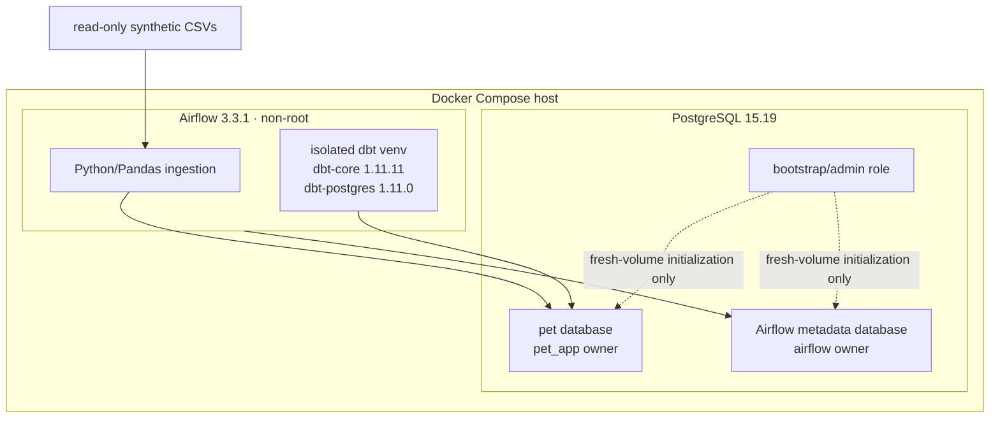
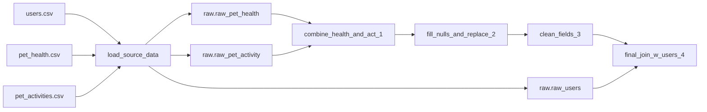

# Architecture

## Goal and workload

The system ingests three complete synthetic CSV snapshots, preserves source-event
provenance, standardizes event semantics, enriches events with pet/owner
attributes, and publishes one tested relational table. The fixture is small and
batch-oriented; the design therefore optimizes for correctness, reproducibility,
and operability rather than distributed throughput.

## Component map



Only PostgreSQL and Airflow are permanent Compose services. dbt is intentionally
not a third service: it runs in an isolated Python virtual environment inside the
Airflow image, avoiding Docker-socket orchestration and dependency coupling with
Airflow's Python environment.

## Data path



The Python boundary handles physical source concerns: required files, exact header
order, explicit integer/date parsing, source bytes, SHA-256, row counts, and
source-row ordinals. dbt handles semantic transformation and data-product
contracts.

## Raw identity

Health and activity rows receive `source_row_number = 1..N` based on CSV data-row
order. dbt prefixes that ordinal with provenance (`health:` or `activity:`) to
form `event_id`. This preserves exact duplicate source rows without inventing a
natural key. It is deterministic for a fixed file version but intentionally not a
general immutable identity strategy for mutable feeds.

`raw_users.pet_id` is the raw primary key. Health/activity use
`source_row_number` as their primary key. The runtime no longer relies on
PostgreSQL `SERIAL` sequences for source event identity.

## Transaction and publication boundaries

The loader first parses all three files before opening the database. Table/schema
compatibility DDL, all three `TRUNCATE` statements, and all inserts execute inside
one PostgreSQL transaction:

```text
parse + validate all files
        ↓
BEGIN
  ensure/migrate raw schema
  truncate users/health/activity
  insert users
  insert health
  insert activity
COMMIT
```

Any exception rolls the transaction back. Airflow sees the exception because the
loader re-raises it.

The subsequent dbt build is a separate task and transaction scope. Therefore the
entire DAG is not one atomic database publication. The operational publication
signal is **successful DAG completion**, not merely successful raw ingestion.

## Orchestration policy

The DAG is manual by design and uses:

- `max_active_runs=1` because concurrent full-refresh runs would compete over the same raw tables;
- one retry after 30 seconds for transient failures;
- eight-minute per-task execution timeout;
- twenty-minute DAG-run timeout;
- `dbt build --fail-fast` so model and test failure stops the task promptly.

Direct manual execution of loader/dbt commands bypasses Airflow serialization and
must not overlap with a DAG run.

## Database security boundary

The PostgreSQL container starts with a cluster bootstrap role. On a fresh volume,
the init script creates two separate login/database ownership domains:

```text
bootstrap/admin role
  ├─ creates pet_app + pet_data
  └─ creates airflow + airflow_db

Airflow container receives:
  ├─ pet_app credentials (loader/dbt)
  └─ airflow credentials (metadata)

Airflow container does NOT receive bootstrap/admin credentials.
```

The split is intentionally simple for a local reference architecture: each runtime
role owns its database rather than receiving cluster-wide superuser privileges.

## dbt materialization strategy

The three transformation layers are views; the final model is a table. This avoids
persisting multiple small intermediate copies while providing a stable physical
serving relation. `UNION ALL` is used because source records must be preserved and
deduplication would both change semantics and add unnecessary work.

The final join is a one-to-one enrichment by `pet_id`, supported by raw user
uniqueness/relationship tests and a reconciliation test that detects loss or
fanout.

## Reliability evidence

The clean-room validator creates an isolated Compose project and proves:

1. Compose config and image build succeed.
2. PostgreSQL and Airflow become healthy.
3. The DAG has no import errors.
4. The real DAG succeeds twice.
5. The second run produces the same business snapshot.
6. A forced PostgreSQL type error rolls the raw transaction back exactly.
7. dbt result artifacts contain only success/pass states.
8. Airflow logs exist.
9. No Docker socket is mounted.
10. Only the validator's randomly named volumes/containers are removed.

## Deliberate boundaries

The project does not claim production HA, TLS, centralized secrets, backup
orchestration, alert routing, or multi-user identity. It also does not add Spark,
streaming, Kubernetes, CDC, or incremental ingestion because those capabilities
are not supported by a demonstrated requirement in this workload.
